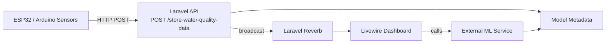

# Architecture

This document contains the project architecture diagram and a short explanation of the main components.

Components:

-   Sensor: ESP32/Arduino devices that POST sensor readings to the API.
-   API: Laravel application handling validation, auth (API key), persistence and broadcasting.
-   DB: `WaterQualityData`, `ModelMetadata`, and `users` (note: `User::$primaryKey = 'user_id'`).
-   Reverb: Laravel Reverb (real-time broadcasting) delivering `WaterQualityCreated` events on channel `water-quality-data-created`.
-   UI: Livewire dashboard components (e.g. `app/Livewire/ClassifyFish.php`) that display charts and call the ML service.
-   ML: External ML endpoints used for prediction and training; `ClassifyFish` calls `https://api.agwasuri.app` for `/predict` and `/train_model`.
