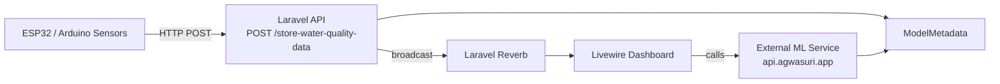

# Agwasuri — Project Notes (README companion)

Consolidated technical notes for the **Agwasuri** water-quality monitoring system.
This file summarizes the repository as analyzed: purpose, stack, structure, data model,
API, real-time flow, Livewire components, classification rules, dev workflow, testing,
and known gaps. It complements the top-level [`README.md`](../README.md) and the
diagram in [`architecture.md`](architecture.md).

> Status: analysis snapshot of the codebase as committed on the current branch
> (`feat/frontend-redesign`-era work). Where the top-level README and the code
> disagree, the code is treated as the source of truth and the discrepancy is listed
> under [Known gaps and discrepancies](#known-gaps-and-discrepancies).

---

## 1. Overview

Agwasuri helps small-scale aquaculture operators, researchers, and municipal officers
collect, visualize, and act on fishpond water-quality data. ESP32/Arduino-class sensors
POST readings over HTTP; Laravel validates, persists, and broadcasts them; a Livewire
dashboard renders KPIs, charts, tables, and AI-driven fish-species recommendations from
an external ML service.

Primary goals:

- Improve pond-management decisions (temperature, pH, dissolved oxygen, salinity).
- Provide reproducible data for research and evaluation.
- Demonstrate a full IoT → web → ML pipeline for aquaculture.

Audience: fish farmers (primary), aquaculture experts, municipal agriculture officers,
researchers.

---

## 2. Stack at a glance

| Layer            | Technology                                                              |
| ---------------- | ----------------------------------------------------------------------- |
| Runtime          | PHP `^8.2` (README states 8.3+)                                         |
| Framework        | Laravel `^11.31`                                                        |
| Frontend         | Livewire `^3.4`, Livewire Volt `^1.0`, Blade, Tailwind CSS              |
| Charts           | ApexCharts `^5.3`, Chart.js `^4.4`, `chartjs-plugin-zoom`, `luxon`      |
| Chart helpers    | `asantibanez/livewire-charts` `^4.1`                                    |
| Real-time        | Laravel Reverb `^1.0` (+ `laravel-echo`, `pusher-js`)                    |
| Build            | Vite `^6`, `laravel-vite-plugin`, PostCSS, Autoprefixer                 |
| Database         | SQLite (quickstart) or MySQL/PostgreSQL (production)                    |
| Testing          | Pest `^3.7` (`pestphp/pest-plugin-laravel`), PHPUnit runner             |
| Tooling          | Pint, Pail, Sail, Faker, Mockery, Husky, commitlint, Playwright, sharp  |
| Broadcasting     | `BROADCAST_CONNECTION` (defaults `null`; `.env.example` sets `log`)     |

`composer.json` autoloads a global helpers file: `app/Support/helpers.php` (via `files`).

---

## 3. Repository layout

```
agwasuri/
├─ app/
│  ├─ Console/Commands/     # Artisan commands (data generation, normalization, deletes)
│  ├─ Events/               # WaterQualityCreated, UserProfileUpdated
│  ├─ Http/
│  │  ├─ Controllers/       # ThemeController, Controller base
│  │  │  ├─ Api/            # WaterQualityDataController, RecommendationController
│  │  │  └─ Auth/           # VerifyEmailController
│  │  └─ Middleware/        # IsAdmin, NormalizeThemeCookie
│  ├─ Livewire/             # Livewire + Volt components (dashboard widgets)
│  ├─ Models/               # User, WaterQualityData, ModelMetadata, FishpondOperator
│  ├─ Observers/            # UserObserver
│  ├─ Providers/            # AppServiceProvider, VoltServiceProvider
│  ├─ Services/             # WaterQualityChartService, SampleWaterQualityService
│  ├─ Support/helpers.php   # classifyWaterParam(), status helpers, color helpers
│  └─ View/                 # Blade view components (if any)
├─ bootstrap/app.php        # App config: routing, middleware aliases, CSRF exceptions
├─ config/                  # app, auth, broadcasting, cache, database, filesystems,
│                           # logging, mail, queue, reverb, services, session,
│                           # water_quality
├─ database/
│  ├─ migrations/           # users, cache, jobs, water_quality_data, model_metadata,
│  │                        # fishpond_operators
│  ├─ seeders/              # DatabaseSeeder, MasterFishpondOperatorsSeeder,
│  │                        # LiveEnvironmentDataSeeder, WaterQualityDataSeeder, data/
│  └─ database.sqlite
├─ notes/                   # Project docs (see §16): agwasuri_notes.md, architecture.md,
│                           #   design/, fixes/, seeding/, reference/, pr/, planning/
├─ resources/
│  ├─ css/                  # app.css, theme-export.css
│  ├─ js/                   # app.js, bootstrap.js, echo.js, theme.js,
│  │                        # waterQualityInit.js, vendor/
│  ├─ fonts/                # Wulkan Display and other fonts
│  └─ views/                # Blade pages + livewire/ components
├─ routes/                  # web.php, auth.php, channels.php, console.php
├─ scripts/                 # dev-start.{js,ps1,sh}, data/sim helpers, smoke tests
├─ tests/                   # Feature/, Unit/, Pest.php, TestCase.php
├─ tools/                   # convert-images-to-webp.cjs
├─ .github/                 # workflows/commitlint.yml, CONTRIBUTING, PR template
├─ composer.json / package.json / vite.config.js / tailwind.config.js
└─ README.md
```

---

## 4. Architecture



Component responsibilities:

- **Sensor** — ESP32/Arduino devices POST readings with a bearer API key.
- **API** — Laravel validates input, authenticates (`user_id` + `api_key`),
  persists `WaterQualityData`, and broadcasts `WaterQualityCreated`.
- **DB** — `water_quality_data`, `model_metadata`, `users` (PK `user_id`),
  `fishpond_operators`.
- **Reverb** — WebSocket server delivering `WaterQualityCreated` on the public
  channel `water-quality-data-created`.
- **UI** — Livewire components render KPI cards, an ApexCharts line chart,
  data tables, recommendations, and admin user management.
- **ML** — External FastAPI-style endpoints `/predict` and `/train_model` at
  `https://api.agwasuri.app`; training timestamps are persisted to `model_metadata`.

---

## 5. Data model

### `users` (`App\Models\User`) — primary key `user_id`

- Identity: `first_name`, `last_name`, `email` (unique), `password` (hashed cast),
  `email_verified_at`.
- `account_type` — normalized on write to `admin` or `user` (accessor/mutator).
  `User::isAdmin()` returns `account_type === 'admin'`.
- Virtual `name` attribute appends `first_name + last_name` (fallback `'User'`).
  A backwards-compatible `id` accessor returns the `user_id` value.
- Device auth: `api_key` (unique, nullable), generated in the seeder/UserForm.
- Profile/pond metadata: `fishpond_name`, `barangay`, `municipality`, `province`,
  `total_fishpond_area`, `species_cultured` (**array cast**), `water_type`,
  `farm_type`, `culture_system`, `culture_method`,
  `activities_during_pond_preperation`, `liming`, `fertilizer`, `disinfectant`,
  `source_of_fingerlings_larvae`, `stocking_density`, `culture_period`,
  `harvest_method`, `total_production_per_cropping`, `feeds`, `amount_per_day`,
  `frequency`, `product_destination`.

### `water_quality_data` (`App\Models\WaterQualityData`)

- Columns: `id`, `recorded_at` (datetime), `temperature`, `salinity`,
  `dissolved_oxygen`, `ph_level` (all float), `user_id` (FK → `users.user_id`,
  cascade delete), timestamps.
- Fillable: `recorded_at`, `temperature`, `salinity`, `dissolved_oxygen`,
  `ph_level`, `user_id`.

### `model_metadata` (`App\Models\ModelMetadata`) — table `model_metadata`

- `model_name` (unique, e.g. `fish_classifier`), `last_trained_at` (datetime cast),
  timestamps. Used by `ClassifyFish` to display the last successful training time.

### `fishpond_operators` (`App\Models\FishpondOperator`)

- Master list of operators/ponds: `name`, `pond_name`, `barangay`, `municipality`,
  `province`, `total_area_ha` (decimal:2), `species_cultured`, `water_type`,
  `contact`, `notes`, `source`, `created_by`, timestamps; index on
  `(pond_name, barangay)`.

---

## 6. HTTP routes and API

`routes/web.php`:

| Method | URI                          | Handler / View                        | Middleware                 |
| ------ | ---------------------------- | ------------------------------------- | -------------------------- |
| GET    | `/`                          | `welcome` view                        | —                          |
| GET    | `/dashboard`                 | `dashboard` view                      | `auth`, `verified`         |
| GET    | `/account_management`        | `account_management` view             | `auth`, `verified`, `isAdmin` |
| GET    | `/profile`                   | `profile` view                        | `auth`                     |
| GET    | `/optimal-fish`              | `optimal-fish` view                   | `auth`                     |
| GET    | `/historical-data`           | `historical-data` view                | `auth`                     |
| GET    | `/troubleshooting`           | `troubleshooting` view                | `auth`                     |
| POST   | `/set-theme`                 | `ThemeController@set` (`theme.set`)   | —                          |
| POST   | `/store-water-quality-data`  | `WaterQualityDataController@store`    | CSRF-exempt                |
| GET    | `/api/water-quality/latest`  | `WaterQualityDataController@latest`   | —                          |
| POST   | `/logout`                    | inline closure (web guard)            | —                          |

`routes/auth.php` registers Volt auth pages: `login`, `register`,
`forgot-password`, `reset-password/{token}`, `verify-email`, `verify-email/{id}/{hash}`
(signed + throttled), `confirm-password`.

### Sensor ingestion — `POST /store-water-quality-data`

- Validation: `user_id` (required, exists), `recorded_at` (required, date),
  `temperature`, `salinity`, `dissolved_oxygen`, `ph_level` (required, numeric).
- Auth: `Authorization: Bearer <API_KEY>` matched against
  `users.user_id` + `users.api_key`. Returns `401` on missing/invalid key.
- On success creates the record and broadcasts `WaterQualityCreated`; returns
  `201 {"success": true}`.
- Quirk: records are only persisted when `temperature != 85.0000` (a sentinel
  filter); otherwise the endpoint returns without a JSON body.
- CSRF is disabled for this route in `bootstrap/app.php`.

Example:

```bash
curl -X POST http://127.0.0.1:8000/store-water-quality-data \
  -H "Authorization: Bearer <API_KEY>" \
  -H "Content-Type: application/json" \
  -d '{"user_id":1,"recorded_at":"2025-11-06 12:00:00","temperature":28.5,"ph_level":7.2,"dissolved_oxygen":6.8,"salinity":15.3}'
```

### Latest readings — `GET /api/water-quality/latest`

- Query params: `user` (user_id), `limit` (default 32).
- Returns ISO-8601 `labels` plus `series` in canonical order:
  `temperature, salinity, dissolved_oxygen, ph_level`.

### Recommendation — `RecommendationController@show`

- Query param `user` (falls back to `session('selected_user')`, then `auth()->id()`).
- Averages the user's readings, calls the external `/predict` endpoint, and returns
  a compact `{species, confidence, reason, computed_at}` shape cached for 120s.
  Falls back to a Tilapia heuristic on failure.

---

## 7. Real-time / broadcasting

- Event: `App\Events\WaterQualityCreated` implements `ShouldBroadcastNow`.
  - Channel: public `water-quality-data-created`.
  - Payload: `{"waterQualityData": { ...model fields... }}`.
- Event: `App\Events\UserProfileUpdated` implements `ShouldBroadcastNow`.
  - Channels: private `admin.users` and `App.Models.User.{user_id}`.
  - Triggered by `UserObserver` when `water_type` changes.
  - `broadcastAs` → `UserProfileUpdated`.
- `routes/channels.php` authorizes `App.Models.User.{id}` (own user) and
  `admin.users` (admins only).
- Client wiring: `resources/js/echo.js` config uses Reverb/Pusher credentials from
  `VITE_REVERB_*`. Livewire components listen via
  `#[On('echo:water-quality-data-created,WaterQualityCreated')]` and
  `echo-private:admin.users,UserProfileUpdated`.

Broadcast config: `config/broadcasting.php` supports `reverb`, `pusher`, `ably`,
`log`, `null`. Reverb server config lives in `config/reverb.php` (host `0.0.0.0`,
port `8080`, apps via `config` provider).

---

## 8. Livewire components

Dashboard and data widgets (`app/Livewire/`):

- **`WaterQualityCard`** — latest reading KPI card per parameter with classification
  badges, deltas vs previous reading, sparkline paths, an overall status, and a
  weighted 0–100 quality score (DO 30%, Temp 25%, pH 25%, Salinity 20%).
- **`WaterQualityChart`** — builds an ApexCharts multi-series line chart from up to
  200 most-recent rows; handles user/date filters, series toggling, and appends
  real-time points without re-rendering (dispatches `water-quality:point`). Includes
  a `dispatchBrowserEvent` shim via Livewire `js()`.
- **`WaterQualityDataTable`** — paginated historical table (50 rows on
  `historical-data`, else 10) with per-row status classification and summary averages.
- **`MeasurementsPreview`** — 5 most-recent readings preview.
- **`UserFilter`**, **`UserTable`**, **`UserForm`** — admin
  account management: search/filter/paginate, create/edit, typed-name delete
  confirmation, bulk delete, user details modal.
- **`ClassifyFish`** — ML client: averages selected user's data, POSTs to
  `/predict`, renders predictions, confidence, metrics, bilingual (EN/TL) status,
  species image resolution, and admin-only `/train_model` with `ModelMetadata`
  persistence.
- **`RecommendationCard`** — compact recommendation widget for the dashboard.
- Removed as dead code during cleanup: `AlertsList`, `DateFilter`, `LogoutLink`
  (superseded by the `/logout` route), `QuickActions`, `UserDetails`,
  `LivewireChartsLineWrapper` (see §16).
- Volt auth pages under `resources/views/livewire/pages/auth/` and profile forms
  under `resources/views/livewire/profile/`.

Volt is mounted on `resources/views/livewire` and `resources/views/pages`
(`VoltServiceProvider`).

---

## 9. Water-quality classification

Source of truth: `config/water_quality.php` (GOOD / CRITICAL labels), backed by
DENR AO 2016-08 and PHILMINAQ guidance.

| Parameter              | GOOD range    | CRITICAL outside                     |
| ---------------------- | ------------- | ------------------------------------ |
| pH (`ph`)              | 6.5 – 9.0     | `< 6.5` or `> 9.0`                   |
| Temperature (`temperature_c`) | 26.0 – 32.0 °C | `< 26.0` or `> 32.0`         |
| Salinity (`salinity_ppt`) | 0.5 – 30.0 ppt | `< 0.5` or `> 30.0`              |
| Dissolved oxygen (`dissolved_oxygen_mg_l`) | ≥ 5.0 mg/L | `< 5.0`              |

Also in config: `thresholds` (for chart annotations) and `status_map`
(badge/value/border Tailwind classes for `GOOD` / `CRITICAL`).

Global helpers in `app/Support/helpers.php`:

- `classifyWaterParam($param, $value)` — returns `label`, `note`, `min`, `max`;
  accepts aliases (`ph`, `pH`, `temperature`, `temp`, `salinity`, `do`,
  `dissolved_oxygen`).
- `water_status_tokens()`, `water_status_from_metrics()` — UI tokens and
  worst-parameter-wins aggregation (`CRITICAL` > `GOOD` > `UNKNOWN`).
- `map_classification_to_status()`, `status_color()`, `hex_to_rgba()`.
- `water_quality_param_keys()`, `water_quality_param_labels()`,
  `water_quality_colors_ordered()` — canonical ordering
  `temperature, salinity, dissolved_oxygen, ph_level`.

Detailed ranges and Philippine study references are in
[`WATER_QUALITY_SCALES.md`](reference/WATER_QUALITY_SCALES.md); scoring notes are in
[`WATER_QUALITY_SCORE.md`](reference/WATER_QUALITY_SCORE.md).

---

## 10. Services, events, observers, middleware, providers

- **Services**
  - `WaterQualityChartService` — builds labels, series, and a fallback serializable
    line-chart array shape.
  - `SampleWaterQualityService` — generates sample measurements (used by commands).
- **Events** — `WaterQualityCreated`, `UserProfileUpdated` (see §7).
- **Observer** — `UserObserver` broadcasts `UserProfileUpdated` on `water_type`
  change; registered in `AppServiceProvider`.
- **Middleware** — `IsAdmin` (redirects non-admins to dashboard, alias `isAdmin`),
  `NormalizeThemeCookie` (appended to the web group; mirrors `theme` →
  `agwasuri_theme` cookie).
- **Providers** — `AppServiceProvider` (observers), `VoltServiceProvider` (Volt mount
  paths).
- **Theme** — `ThemeController@set` writes `agwasuri_theme` + `theme` cookies and
  returns JSON; client logic in `resources/js/theme.js`.

---

## 11. Artisan commands and scripts

Artisan commands (`app/Console/Commands/`):

- `GenerateHistoricalData`, `GenerateWaterQualityRange`, `SampleWaterQuality` —
  sample/realtime data generation (e.g. `php artisan sample:water-quality --count=5`).
- `SeedWaterQualitySamples` — seed sample readings.
- `NormalizeAccountTypes`, `NormalizeWaterTypes` — data hygiene.
- `DeleteBulkUsers`, `DeleteWaterQualityForUser` — maintenance/deletion.

Scripts (`scripts/`):

- `dev-start.js` / `dev-start.ps1` / `dev-start.sh` — cross-platform dev bootstrap
  (`npm run dev-start`; destructive reset via `--fresh` / `-Fresh`).
- `generate-water-quality-data.ps1`, `playwright-smoke.js`,
  `rebuild-assets-windows.ps1`, `check-users.php`, `clear_water_quality.php`.

npm scripts (`package.json`): `build`, `build:theme`, `dev`, `dev-start`,
`dev-start:win`, `dev-reset`, `convert-webp`.

---

## 12. Configuration and environment

Key `.env` values:

```env
DB_CONNECTION=sqlite        # or mysql/pgsql
DB_DATABASE=database/database.sqlite
BROADCAST_CONNECTION=reverb # local realtime; .env.example defaults to log
SESSION_DRIVER=database
QUEUE_CONNECTION=database
CACHE_STORE=database
REVERB_APP_ID= / REVERB_APP_KEY= / REVERB_APP_SECRET=
REVERB_HOST= / REVERB_PORT=8080 / REVERB_SCHEME=http
VITE_REVERB_APP_KEY= / VITE_REVERB_HOST= / VITE_REVERB_PORT=
```

- `phpunit.xml` runs with `APP_ENV=testing`, array cache/session, sync queue,
  `BCRYPT_ROUNDS=4`. SQLite in-memory lines are present but commented out.
- `.env.testing` currently targets a MySQL `agwasuri_test` database.
- `bootstrap/app.php` registers middleware aliases, appends `NormalizeThemeCookie`
  to the web group, and exempts `store-water-quality-data` from CSRF.

---

## 13. Local development

```pwsh
# 1. Dependencies
composer install
npm install

# 2. Environment
copy .env.example .env
php artisan key:generate

# 3. SQLite quickstart
#    DB_CONNECTION=sqlite, DB_DATABASE=database/database.sqlite
if (-not (Test-Path database\database.sqlite)) { New-Item database/database.sqlite -ItemType File }

# 4. Migrate + optional packages
php artisan migrate --seed
php artisan reverb:install
php artisan livewire-charts:install

# 5. (Optional) admin account
#    README suggests: pwsh ./scripts/create-admin.ps1  (script absent — see gaps)
#    In practice the admin account is created by `php artisan migrate --seed`.

# 6. Full dev stack (server + reverb + vite)
composer run dev
# or: pwsh ./scripts/dev-start.ps1
```

Manual alternative:

```pwsh
php artisan serve --host=0.0.0.0 --port=8000
php artisan reverb:start
npm run dev
```

Seeded accounts (`DatabaseSeeder`): `admin@admin.com` / `admin1234` (admin),
`test@test.com` / `test1234`, `test_1@test.com` / `test1234`.

---

## 14. Testing

- Runner: Pest (`pestphp/pest`), config in `tests/Pest.php`, suites in `phpunit.xml`.
- Feature tests apply `RefreshDatabase` automatically.
- Commands:

```pwsh
php artisan test
./vendor/bin/pest
php artisan test --filter=WaterQualityDataTest
```

Existing tests: `tests/Feature/Auth/*`, `tests/Feature/ProfileTest.php`,
`tests/Feature/ExampleTest.php`, `tests/Unit/StatusMapPHPUnitTest.php`,
`tests/Unit/ExampleTest.php`. Ensure `.env.testing`/test DB is available; some
real-time tests may need `php artisan reverb:start`.

---

## 15. Known gaps and discrepancies

Findings worth tracking (documented, not yet fixed):

1. **Missing `config/water_colors.php`** — `config('water_colors.series')` is used in
   `WaterQualityChart`, `WaterQualityCard`, `helpers.php`, and
   `resources/views/layouts/app.blade.php`, but no such config file exists. Colors
   always fall back to hardcoded defaults (`#EF4444`, `#14B8A6`, `#2563EB`, `#8B5CF6`).
2. **`status_colors` not defined** — `status_color()` and
   `WaterQualityChart::loadData()` read `config('water_quality.status_colors')`, which
   is absent from `config/water_quality.php`; the helper falls back to gray.
3. **Status vocabulary drift** — `status_map` in `config/water_quality.php` uses
   `GOOD`/`CRITICAL`, while the top-level `README.md` documents
   `GOOD`/`BAD`/`HARMFUL`, and `WATER_QUALITY_SCALES.md` uses
   `GOOD`/`BAD`/`HARMFUL`. Reconcile to a single canonical set.
4. **Docs relocation (resolved)** — the former `docs/` directory was moved into a
   grouped `notes/` tree (see §16), and `README.md` links were repointed to `notes/`.
   `CONTRIBUTORS.md` is still absent (credits now point to `.github/CONTRIBUTING.md`).
   The `config/water_quality.php` `meta.source` string was updated to
   `notes/reference/WATER_QUALITY_SCALES.md`.
5. **Temperature sentinel** — ingest silently discards readings equal to `85.0000`
   and returns no JSON body in that branch (`WaterQualityDataController@store`).
6. **`config('water_colors')` and `status_colors` note** aside, `RecommendationController`
   has no route registered in `routes/web.php`; it is used as a class reference by
   `ClassifyFish::PREDICT_ENDPOINT` but is not directly routable as written.
7. **Legacy/backup artifacts** — the `.blade.php.backup`, `.blade.php.before-ph-fix`,
   `composer.json.bak`, `.env.testing.bak`, and `tmp_dashboard.html` artifacts were
   removed during cleanup (see below).
8. **README vs code versioning** — README requires PHP 8.3+ while `composer.json`
   allows `^8.2`.
9. **Missing `scripts/create-admin.ps1`** — the README's optional admin-reset step
   references `pwsh ./scripts/create-admin.ps1`, but the `scripts/` directory does not
   contain it (admin account is instead seeded by `DatabaseSeeder`).

---

## 16. Related documentation

- [`architecture.md`](architecture.md) — rendered architecture diagram.
- [`design/`](design/) — [`WEB_DESIGN.md`](design/WEB_DESIGN.md), [`UI_CHANGES.md`](design/UI_CHANGES.md).
- [`fixes/`](fixes/) — [`CHART_FIX_LOG.md`](fixes/CHART_FIX_LOG.md),
  [`CHART_FIX_SUMMARY.md`](fixes/CHART_FIX_SUMMARY.md), and
  [`BUGFIX_CHART_STATIC_RENDER.md`](fixes/BUGFIX_CHART_STATIC_RENDER.md).
- [`seeding/`](seeding/) — [`DEV-SEEDING.md`](seeding/DEV-SEEDING.md),
  [`DEV-SEEDING-CLI.md`](seeding/DEV-SEEDING-CLI.md).
- [`reference/`](reference/) — [`WATER_QUALITY_SCALES.md`](reference/WATER_QUALITY_SCALES.md),
  [`WATER_QUALITY_SCORE.md`](reference/WATER_QUALITY_SCORE.md), and
  [`Physical-and-Natural-Resources.pdf`](reference/Physical-and-Natural-Resources.pdf).
- [`pr/`](pr/) — [`PR_BODY.md`](pr/PR_BODY.md).
- [`planning/`](planning/) — [`todo.json`](planning/todo.json).
- PR template lives in [`../.github/PULL_REQUEST_TEMPLATE.md`](../.github/PULL_REQUEST_TEMPLATE.md).

### Cleanup performed

Removed unused backup/temp artifacts (tracked in git, so recoverable):

| Removed file                                                   | Reason                                   |
| -------------------------------------------------------------- | ---------------------------------------- |
| `resources/views/components/sidebar.blade.php.bak`             | stale backup; original `.blade.php` kept |
| `resources/views/livewire/classify-fish.blade.php.backup`      | stale backup; original kept              |
| `resources/views/livewire/water-quality-card.blade.php.before-ph-fix` | stale backup; original kept       |
| `composer.json.bak`                                            | stale backup; `composer.json` kept       |
| `.env.testing.bak`                                             | stale backup; `.env.testing` kept        |
| `tmp_dashboard.html`                                           | temp rendered HTML dump (contained a CSRF token) |

Removed unreferenced "dead code" (no `<livewire:...>`/view/route references; tracked in git):

| Removed                                                       | Reason                                    |
| ------------------------------------------------------------- | ----------------------------------------- |
| `app/Livewire/AlertsList.php` + `livewire/alerts-list.blade.php` | never rendered                         |
| `app/Livewire/DateFilter.php` + `livewire/date-filter.blade.php` | superseded by chart/table filters      |
| `app/Livewire/LogoutLink.php` + `livewire/logout-link.blade.php` | superseded by the `/logout` route      |
| `app/Livewire/QuickActions.php` + `livewire/quick-actions.blade.php` | never rendered                    |
| `app/Livewire/UserDetails.php` + `livewire/user-details.blade.php` | user-table has its own details modal |
| `app/Livewire/LivewireChartsLineWrapper.php`                  | never rendered                            |
| `livewire/data-source-toggle.blade.php`                       | orphaned view                             |
| `livewire/demo-data-auto-insert.blade.php`                    | orphaned view                             |
| `resources/views/manual-entry.blade.php`                      | unrouted page referencing a non-existent `manual-data-entry` component |
| `resources/views/components/right-panel.blade.php`            | never included                            |
| `notes/WEB_REDESIGN.MD`                                       | 0-byte empty file                         |

Housekeeping applied: `README.md` links repointed from `docs/` to `notes/`
(plus a `notes/agwasuri_notes.md` link and `.github/CONTRIBUTING.md` for credits);
`.gitignore` extended with `*.bak`, `*.backup`, `*.before-*`, `*.orig`, `*~`;
compiled/cache files cleared via `php artisan optimize:clear`.

### Organization pass

`notes/` was grouped by intent (previously a flat pile of unrelated docs), and stray
root/config files were tidied — all documentation-only, no runtime impact:

| Move                                                     | To                                   |
| -------------------------------------------------------- | ------------------------------------ |
| `WEB_DESIGN.md`, `UI_CHANGES.md`                          | `notes/design/`                      |
| `CHART_FIX_LOG.md`, `CHART_FIX_SUMMARY.md`, `BUGFIX_CHART_STATIC_RENDER.md` | `notes/fixes/` |
| `DEV-SEEDING.md`, `DEV-SEEDING-CLI.md`                    | `notes/seeding/`                     |
| `WATER_QUALITY_SCALES.md`, `WATER_QUALITY_SCORE.md`, `Physical-and-Natural-Resources.pdf` | `notes/reference/` |
| `PR_BODY.md`                                              | `notes/pr/`                          |
| `PULL_REQUEST_TEMPLATE.md`                                | back to `.github/` (GitHub only reads it there) |
| `todo.json` (repo root)                                   | `notes/planning/todo.json`           |

Also: `.gitmessage` rewritten as a real Conventional Commits template (it previously
held one leftover commit message). Activate it with
`git config commit.template .gitmessage` if you want Git to use it. Links in
`README.md`, this file, `.github/instructions/copilot-instructions.md`, and
`notes/planning/todo.json` were updated to the new paths.

---

_Analysis notes generated for the Agwasuri repository. Update alongside code changes so
this companion stays in sync with `README.md`._
